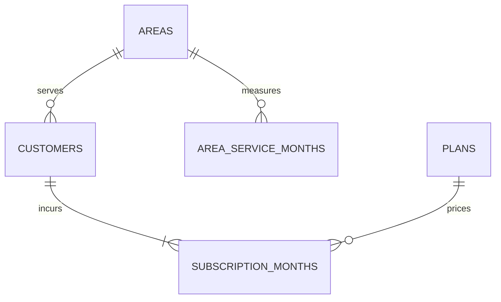

# Telecom Retention, Reliability and Revenue Analytics

**Python · SQL · Cohort analysis · Synthetic subscription data**

## Business question
A fictional internet provider launched in January 2024 and wants to grow without overlooking customer exits. This project asks: **how do retention, service reliability, acquisition mix and billing adjustments relate to subscription performance?** It provides a reproducible descriptive analysis, not a churn prediction model.

## Executive findings
- December 2025 closing subscribers: **2,930**.
- Net subscription revenue across the observed period: **NGN 474.22 million**.
- Monthly exposure-based churn across all customer-months: **2.79%**. This is not a two-year customer churn probability.
- End-of-month-12 retention: **71.7%**, pooled only across cohorts with 12 observed months (age 11).
- Highest observed acquisition-channel monthly churn: **Digital**, **3.02%**. This is descriptive, not a causal channel effect.
- December 2025 net ARPU: **NGN 13,405** per exposed customer-month.


## Executive dashboards
Two static, Python-generated 16:9 pages follow the supplied dashboard references: deep-teal, pale-mint and warm-amber styling, a left sidebar, compact KPI cards with sparklines, doughnut charts, comparative bars and striped scorecards. Page 1 covers subscribers, revenue and acquisition channels; page 2 covers retention and service reliability. Sparklines show 24 monthly observations with independent scales; headline metrics use the periods stated on each card. The sidebar and scope labels are static, not interactive controls. PNG and PDF exports require no Python to view. No HTML is included.


## Dataset and relationships
All records are synthetic, generated with seed 271828. Monthly observations span January 2024–December 2025. Customers activate at month start, receive service for the full month, and may leave at month end. There is no pre-existing customer base, reactivation, midmonth proration, prepaid usage or household linkage. There are no names, contact details or real personal identifiers.

| Raw CSV | Rows |
|---|---:|
| plans.csv | 3 |
| areas.csv | 5 |
| customers.csv | 4,000 |
| area_service_months.csv | 120 |
| subscription_months.csv | 37,551 |

One subscription_months row represents one customer in one billed month. Areas have 24 shared monthly service observations each. Customers belong to one fixed area and one acquisition channel, while their plan can change at month boundaries. The data dictionary explains every source column and the derived measures.



Area and month jointly connect customer observations to service records. The unique area-month index prevents join fan-out. `subscription_mart` contains only eligible customer histories.

## Realism and scenario assumptions
- 4,000 customers activate unevenly across months, with acquisition bursts and growth over time. Areas, segments and channels have unequal shares.
- Three plans differ in price and included usage. Monthly plan switching is allowed, and usage is right-skewed and capped at the allowance. No overage billing is modeled.
- A uniform 8% price increase applies from January 2025; stored monthly fees preserve this history. Base plan prices remain the reference prices, not current billing values.
- Digital acquisitions receive 15% off their first three billed months. A simulated higher exit probability follows promotion expiry; this is an injected scenario, not a real telecom benchmark.
- Outages are right-skewed and shared by area-month. Outer North experiences a deliberately worse period in March–June 2025. Support-ticket demand rises with disruption and near-limit usage.
- Outage exposure above eight hours triggers a 10% service credit on fees after promotional discounts.
- Churn probability varies with tenure, outages, support burden, autopay and a hidden customer propensity. These dependencies create analytical patterns but do not validate causal claims.
- Satisfaction scores are optional; departing customers have a lower response probability. Missing scores are not filled with zero, and survey responses should not be assumed representative.
- NGN prices are invented. Revenue here means net full-month subscription service charges; no cash collections, bad debt, tax, refunds outside credits, operating costs or profit are modeled.

## Data quality and SQL workflow
Raw data includes 100 exact duplicate monthly records, 120 mixed-format month dates, 180 padded uppercase status labels, 20 invalid plan references and 15 negative fee entries. Each invalid billing/reference row belongs to a different customer. Survey nulls reflect modeled nonresponse rather than source corruption.

`pipeline.py` validates numeric syntax, loads raw CSVs into SQLite, and executes `sql/01_clean.sql`. SQL standardizes dates and statuses, removes exact duplicate copies and separates invalid rows. To keep retention histories continuous, it quarantines **all observations belonging to the 35 affected customers**, rather than leaving holes in their timelines. This conservative rule sacrifices coverage and can introduce selection bias; a real company should repair the source records where possible.

After cleaning there are **3,965 eligible customers**, **37,137 usable monthly rows**, and **314 quarantined monthly rows**. `invalid_rows.csv` identifies the 35 directly invalid observations; `quarantine.csv` includes related histories. The unfiltered customers table is retained for auditing; use eligible_customers for cohort denominators.

The answer key in `reports/injected_issues.csv` documents intentional corruption but is not used by the cleaner. Invalid raw plan IDs are child foreign-key failures; unused dimension rows alone would not indicate broken integrity.

Seven SQL checks validate references, area membership, billing and usage bounds, chronology, history continuity, exit sequencing and outage bounds. Python also checks raw-to-clean row reconciliation, unchanged row counts through joins, opening-to-closing customer flow and SQLite integrity.

## Metrics and interpretation
| Metric | Definition |
|---|---|
| Exposed customers | Customers receiving service during the month; opening plus newly acquired |
| Opening subscribers | Current month rows with tenure greater than zero |
| Acquisitions | Current month rows with tenure zero |
| Churned subscribers | Exposed customers whose end_status is churned |
| Closing subscribers | Opening + acquisitions − exits |
| Monthly exposure churn | Exits / exposed customers, including first-month customers |
| Net subscription revenue | Gross monthly fees − promotion discounts − service credits |
| Net ARPU | Net subscription revenue / exposed customer-months |
| Cohort retention at age k | Customers retained at the end of age k / eligible activation cohort size |
| Month-12 retention | End of age 11, pooled over cohorts with 12 months of observation |
| Support intensity | Ticket count / customer-month count × 100 |

This project's exposure-based churn denominator differs from an opening-base-only metric. First-month exits are included in both numerator and exposure. The combined two-year rate is total exits / total customer-months, not customers lost / customers acquired. Month 0 retention can be below 100%; it measures the end of the first service month. Unobserved future cohort cells remain blank, while observed cohorts with no survivors show zero. Never fill unobserved cells with zero.

An area outage is shared across customers. Customer-weighted outage metrics represent subscriber exposure, while the area_service_months table measures network conditions once per area-month. Do not sum repeated outage hours in the customer mart and report them as network downtime.

## Analysis
### Compare retention at the same customer age

Grey cells have not yet been observed. Month 0 can be below 100% because first-month exits are included.

### Acquisition can conceal an underlying retention problem

Opening + new − exits = closing customers. This is a newly launched fictional provider; opening base starts at zero.

### Early-life churn differs from later customer experience

Exposure includes new and opening customers. Older tenure groups contain survivors and fewer acquisition cohorts.

### Service disruption and customer friction move together

Descriptive association with shared area-month exposures. Same-month outages are not a prospective churn prediction.

### Reconcile headline fees to net subscription revenue

Full-month service assumed, including final month. Taxes, collections, bad debt and operating costs are outside scope.

### Read revenue and retention together

Bubble area represents customer-months. Customer mix and plan switching prevent a causal ranking of plan quality.

### Compare acquisition channels within customer tenure

Digital promotion expires after the first three billed months in the simulation. Other customer differences remain uncontrolled.

## Recommendations
1. Investigate early-life exits and the period after promotions end. Test onboarding or renewal communication with a randomized comparison before claiming a retention benefit.
2. Review high-disruption areas with the network team. A comparison across areas and time needs customer mix and shared exposures considered before assigning causality.
3. Compare acquisition channels at matched tenure and observation windows; lifetime churn shares unfairly penalize older cohorts.
4. Review net billing rather than headline plan prices. Add acquisition and servicing costs before evaluating channel profitability or lifetime value.
5. Track survey response coverage, repair invalid billing records at source and monitor customer-history exclusions.

## Limitations
The relationships are invented and not calibrated against a real ISP. There are only five areas, so thousands of customer rows do not mean thousands of independent outage exposures. Churn and service measures within the same month are contemporaneous; using them to predict earlier churn would leak information. There is no prediction model, causal estimate, lifetime value estimate, external benchmark or forecast in this project. End-of-period survivors are right-censored; recent cohorts cannot support long-horizon retention claims. Plan switching and customer mix confound plan comparisons. Whole-history exclusions change the customer population.

## Reproduce the work
Python 3.10+ is required only to rerun code. Extract the ZIP and open a terminal **in the folder containing requirements.txt**:

```bash
python -m pip install -r requirements.txt
python pipeline.py
```

Windows users can double-click RUN_WINDOWS.bat or use `py` instead of `python`. If requirements.txt cannot be opened, open the extracted folder in File Explorer, type `cmd` in its address bar and run the commands there.

Included raw files are reused. `python generate_data.py` deliberately regenerates them. `python analysis/eda.py` rebuilds charts, findings and README after prepared data exists. `python dashboard/dashboard.py` rebuilds both dashboard pages. Edit README_TEMPLATE.md to preserve custom write-up changes across pipeline reruns.

## Files to upload to GitHub
| Path | Purpose |
|---|---|
| data/raw/ | Five complete synthetic source datasets |
| data/clean/ | Clean tables, eligible population, mart and quarantine |
| generate_data.py | Reproducible longitudinal simulation |
| pipeline.py | Loading, SQL execution, validation and report generation |
| sql/ | Cleaning, seven analyses and seven validation queries |
| analysis/eda.py | Seven explanatory Python charts |
| analysis/findings.md | Calculated executive findings |
| dashboard/dashboard.py | Python dashboard builder |
| dashboard/dashboard.pdf | Two-page dashboard report |
| charts/ | Standalone chart PNGs |
| reports/ | Analytical CSVs and quality reports |
| DATA_DICTIONARY.md | Column definitions, grains and units |
| README_TEMPLATE.md | Editable documentation source |
| telecom.sqlite | Optional ready-to-query database; pipeline can rebuild it |

Upload the extracted contents with README.md at repository root, preserving folder paths. Exclude the ZIP, __pycache__ and virtual environment.

Repository name: `telecom-retention-revenue-analytics`

Description: Python and SQL portfolio exploring customer retention, service reliability and subscription revenue using synthetic telecom data, cohort analysis and executive dashboards.

Commit: `Add telecom analytics with synthetic data, SQL cleaning, Python EDA and dashboards`
